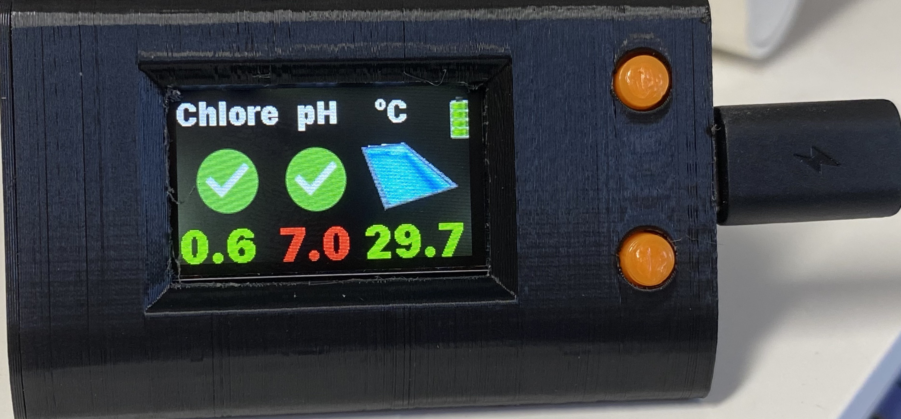
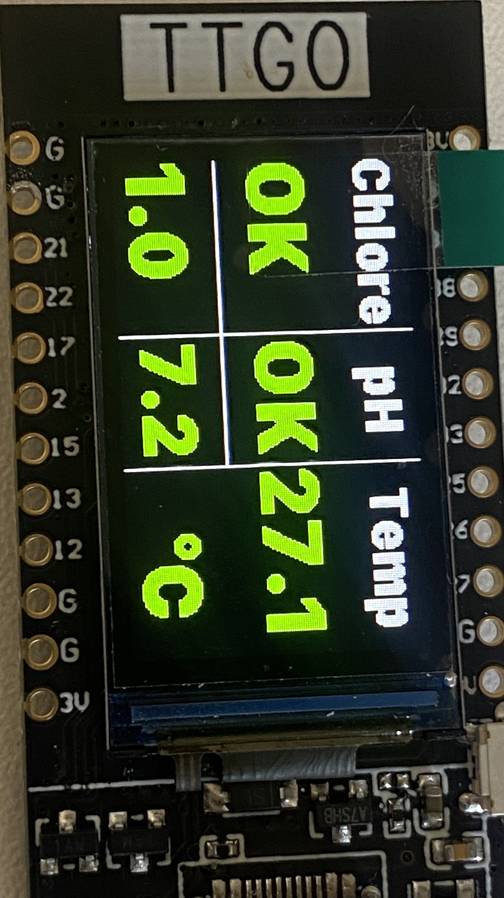
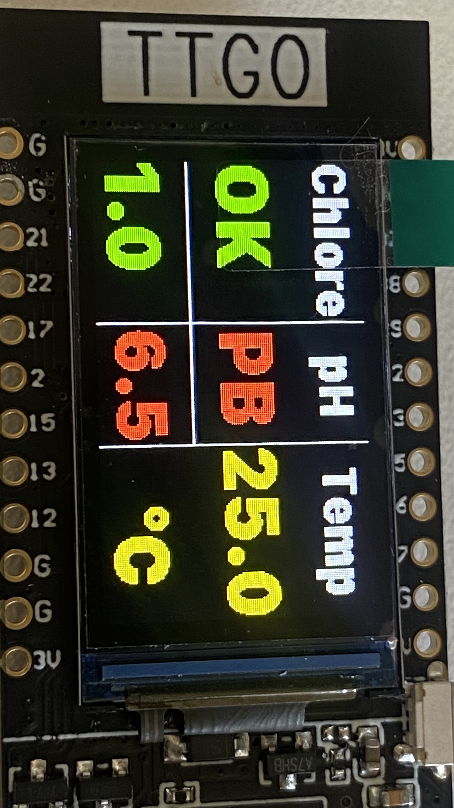
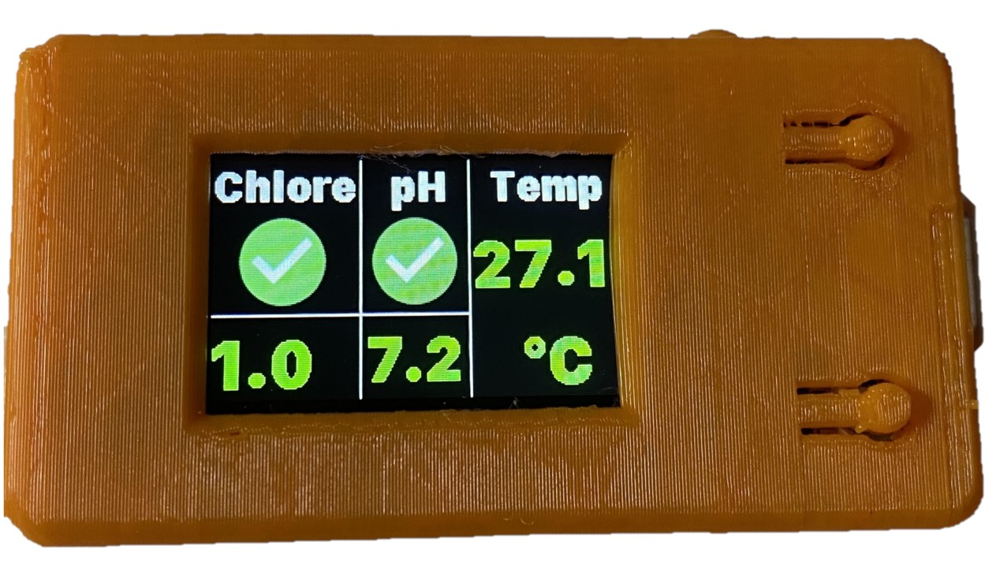

# 🏊‍♂️ Affichage Flipr pour Home Assistant

<p align="center">
  
</p>

<p align="center">
  <a href="https://esphome.io"></a>
  <a href="https://www.home-assistant.io"></a>
  <a href="https://github.com/Xinyuan-LilyGO/TTGO-T-Display"></a>
  <a href="LICENSE"></a>
</p>

---

[](https://www.buymeacoffee.com/Socrate)

## 📖 Présentation

Ce projet permet d'afficher en temps réel et de manière autonome les relevés de votre sonde connectée de piscine **Flipr** sur un écran couleur compact **LILYGO TTGO T-Display 1.14" (ESP32)**.

L'affichage est piloté par **ESPHome** et se synchronise automatiquement avec votre instance **Home Assistant** (via l'intégration officielle Flipr ou MQTT).

### ✨ Points forts
- 📊 **Lecture instantanée** : Température de l'eau, pH, niveau de chlore / Redox.
- 🎨 **Code couleur dynamique** : 
  - 🟢 **Vert** : Paramètres optimaux.
  - 🟡 **Jaune** : Valeur à surveiller.
  - 🔴 **Rouge** : Action requise.
- 🔘 **Navigation par boutons physiques (V3)** : Bascule multi-écrans et commande d'éclairage.
- 🔋 **Suivi matériel** : État de la batterie du Flipr avec jauges visuelles.
- 📦 **Boîtier 3D compact** : Fichiers STL officiels disponibles pour une intégration parfaite au bord du bassin ou dans la maison.

---

## 📸 Aperçu des Écrans

| Statut Nominal (Tout OK) | Statut Alerte (Ajustement requis) | Boîtier 3D avec écran V3 |
| :---: | :---: | :---: |
|  |  |  |

---

## 📑 Comparatif des Versions

Le dépôt propose 3 configurations progressives selon vos besoins :

| Version | Fichier YAML | Interface | Boutons | Fonctionnalités clés |
| :--- | :--- | :---: | :---: | :--- |
| **V1 (Essentielle)** | [`flipr_display_v1.yaml`](esphome/flipr_display_v1.yaml) | Texte simple | ❌ | Température, pH, Chlore, code couleur vert/jaune/rouge. |
| **V2 (Graphique)** | [`flipr_display_v2.yaml`](esphome/flipr_display_v2.yaml) | Logos d'état | ❌ | Remplacement du texte par des logos visuels (Check / Alert). |
| **V3 (Complète ⭐)** | [`flipr_display_v3.yaml`](esphome/flipr_display_v3.yaml) | Multi-pages | ✅ *(2 boutons)* | **Écran 1** : Mesures piscine & alertes.<br>**Écran 2** : Jauge batterie Flipr, date/heure du dernier relevé.<br>**Contrôle** : Allumage/extinction éclairage piscine (relais Zigbee/Sonoff). |

---

## 🛠️ Matériel Requis

1. **Module ESP32 avec écran LCD** : [LILYGO TTGO T-Display 1.14" ST7789V](https://github.com/Xinyuan-LilyGO/TTGO-T-Display).
2. **Câble d'alimentation** : USB Type-C.
3. **Boîtier imprimable en 3D** : Fichiers STL disponibles sur [le dépôt officiel LilyGO 3D Files](https://github.com/Xinyuan-LilyGO/TTGO-T-Display/tree/master/3d_file).
4. **Sonde Flipr** : Avec compte actif et intégrée dans votre Home Assistant.

---

## 🚀 Guide d'Installation

### 1. Préparation des fichiers dans Home Assistant
Dans votre dossier Home Assistant `/config/esphome/` :
1. Choisissez et copiez l'une des configurations YAML (ex: [`flipr_display_v3.yaml`](esphome/flipr_display_v3.yaml)).
2. Copiez le sous-dossier [`esphome/images/`](esphome/images/) contenant les icônes.
3. Téléchargez la police TrueType [**SF Compact**](https://font.gooova.com/fonts/14164/sf-compact-font-family.html) et nommez-la `SFCompact.ttf` dans votre dossier `/config/esphome/`.

### 2. Configuration des secrets (`secrets.yaml`)
Créez ou complétez le fichier `/config/esphome/secrets.yaml` (modèle fourni dans [`secrets.yaml.example`](secrets.yaml.example)) :

```yaml
key_display_p: "votre_cle_chiffrement_api_esphome"
ota_display_p: "votre_mot_de_passe_ota"
wifi_ssid: "Mon_Reseau_WiFi"
wifi_password: "Mon_Mot_De_Passe_WiFi"
mdp_hotspot: "Mon_Mot_De_Passe_Hotspot"
server_username: "admin"
server_password: "Mon_Mot_De_Passe_Admin"
```

### 3. Personnalisation des entités dans le YAML
Au début du fichier YAML choisi, personnalisez les variables de substitution avec le numéro de série de votre Flipr :

```yaml
substitutions:
  devicename: affichageflipr
  frendlyname: "Affichage Flipr"

  # Capteurs Flipr dans Home Assistant :
  entity1: sensor.flipr_XXXXXXXX_water_temperature
  entity2: sensor.flipr_XXXXXXXX_ph
  entity3: sensor.flipr_XXXXXXXX_chlorine
  entity4: binary_sensor.flipr_XXXXXXXX_chlorine_status
  entity5: binary_sensor.flipr_XXXXXXXX_ph_status
  entity6: sensor.flipr_XXXXXXXX_last_measured
  entity7: sensor.flipr_XXXXXXXX_batterie

  # Entité optionnelle pour la lampe de piscine (V3) :
  relailampe: switch.relai_piscine

  # Seuils de déclenchement des alertes couleur :
  temp_mini: "26"
  temp_maxi: "31"
  ph_mini: "7.0"
  ph_maxi: "7.4"
  chlore_mini: "0.5"
  chlore_maxi: "3.0"
```

### 4. Téléversement
- Branchez le TTGO T-Display en USB sur votre machine ou flashez directement en OTA depuis le tableau de bord ESPHome.
- Dès la fin du téléversement, les binary sensors se synchronisent instantanément, et les valeurs de température, pH et chlore s'affichent en quelques secondes.

---

## 🎮 Fonctionnement des Boutons (Version 3)

La carte LILYGO dispose de deux boutons physiques en façade :
- **Bouton 1 (Haut / GPIO35)** : Bascule entre l'écran principal des mesures et l'écran secondaire (état batterie & dernier relevé).
- **Bouton 2 (Bas / GPIO0)** : Commutation marche / arrêt de la lumière de la piscine via l'entité Home Assistant configurée.

---

## 📁 Structure du Répertoire

```text
Affichage-Flipr-HomeAssistant/
├── README.md                 # Documentation complète du projet
├── LICENSE                   # Licence open-source MIT
├── .gitignore                # Exclusion des fichiers temporaires & secrets
├── secrets.yaml.example      # Gabarit d'exemple des identifiants et clés Wi-Fi
├── docs/
│   └── images/               # Photos de démonstration et captures d'écran
│       ├── IMG-1884.jpg      # Photo principale V3
│       ├── avecbox.jpg       # Rendu avec boîtier 3D
│       ├── aveclogo.jpg      # Démo V2 avec logos
│       ├── view_ok.jpg       # Rendu statut OK (vert)
│       └── view_pb.jpg       # Rendu statut Alerte (jaune/rouge)
└── esphome/
    ├── flipr_display_v1.yaml # Configuration V1 (Texte simple)
    ├── flipr_display_v2.yaml # Configuration V2 (Logos graphiques)
    ├── flipr_display_v3.yaml # Configuration V3 (Boutons, multi-pages, éclairage)
    └── images/               # Icônes et assets graphiques du firmware
        ├── alert.jpg / alert.png
        ├── check-circle.jpg / check-circle.png
        ├── piscine.png / piscine_on.png / piscine_off.png
        ├── lampe_on.png / black.png
        └── ba_*.png / bav_*.png (Jauges de batterie)
```

---

## 🤝 Contribution & Remerciements

Les contributions, issues et suggestions d'amélioration sont les bienvenues ! N'hésitez pas à forker le dépôt et à proposer vos pull requests.

- Projet basé sur [ESPHome](https://esphome.io) et l'intégration [Flipr pour Home Assistant](https://www.home-assistant.io/integrations/flipr/).
- Boîtier et documentation matérielle : [LilyGO TTGO T-Display](https://github.com/Xinyuan-LilyGO/TTGO-T-Display).
